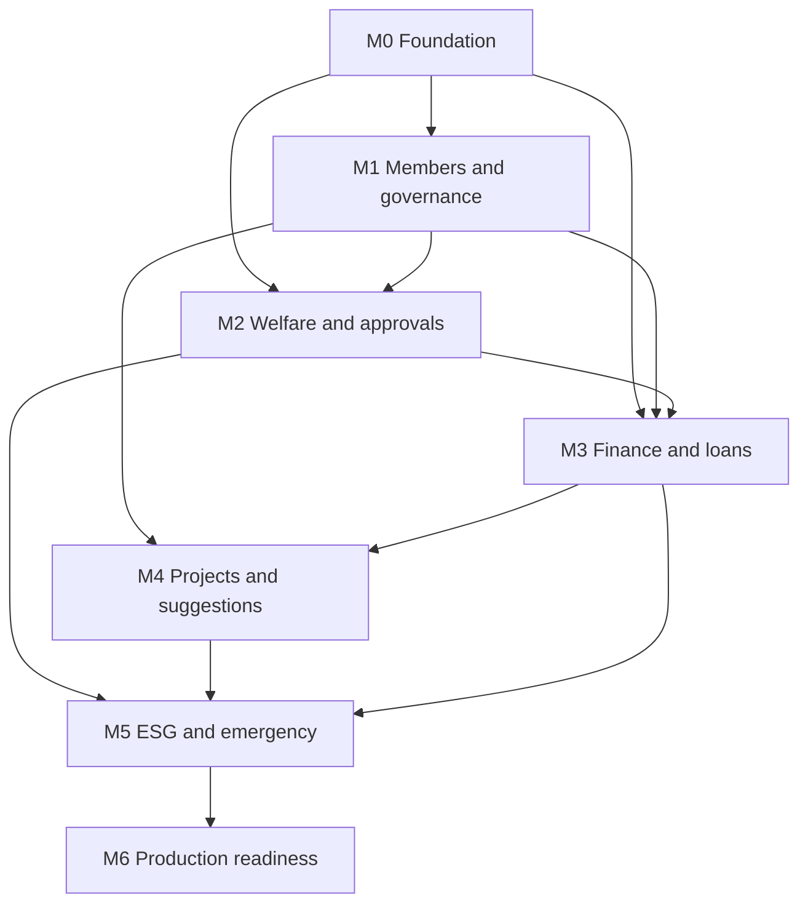

# SAHANA Implementation Plan

Status: planning baseline, 31 October 2026.
This plan orders the work. It does not approve business formulas. SRS 001 and SRS 034 still require stakeholder acceptance of scope, and OD 01–OD 08 still block the slices named in `docs/requirements/TRACEABILITY_MATRIX.md`.

All approved MVP modules stay in scope. Milestones are the build order, not a cut of scope.

## How to use this plan

- Build one vertical slice at a time: schema, API, authorization, web or mobile UI, three languages, tests, docs.
- Do not start a milestone's feature work until the previous milestone's exit gate has passed, except for writing the next milestone's plan.
- A slice blocked by an open decision stays at schema-only or is skipped. Record the skip in the task report. Do not invent the rule.

## Dependency overview

Emergency coordination needs the approval engine and the ledger hook, so it sits in Milestone 5 even though the mobile entry point is a member feature. Notifications scaffolding is Milestone 0; channel providers wait on OD 06.

## Milestone 0 — Foundation

Goal: a deployable skeleton with identity, society isolation, configuration, localization, and a responsive shell. No welfare or finance behavior.

Deliverables:

- pnpm workspace matching the layout in `DEVELOPMENT_GUIDE.md`.
- API process with health and version endpoints, request ids, structured logs, and a central error mapper.
- PostgreSQL migrations for societies, users, roles, permissions, sessions, audit events, and versioned configuration. Tenancy middleware that rejects an unscoped request.
- Authentication and server-side RBAC. MFA enrollment hook present; enforcement for privileged roles turned on before production, not necessarily in the first local slice.
- `packages/i18n` with English, Sinhala, and Tamil namespaces and a completeness check.
- `packages/design-tokens` and a web shell that completes one sample task at 320px, tablet, and desktop.
- Mobile shell that signs in, shows society-scoped profile placeholder, and surfaces a non-functional emergency entry point labeled as not yet submitting.
- CI: install, typecheck, lint, unit tests, migrations on disposable PostgreSQL.
- Central configuration for the safe keys in SRS 028. Secrets remain outside the settings UI (SRS 030).

Exit gate: see `docs/architecture/MILESTONE_0_PLAN.md`. Do not begin Milestone 1 feature code until that plan is approved and its gate has passed.

Blocked until accepted: TD-01 tenancy enforcement detail, TD-02 ORM, TD-03 mobile runtime, TD-04 session mechanism, TD-05 background jobs. Milestone 0 may proceed on the proposed defaults only after those decisions are accepted or explicitly waived for the foundation.

## Milestone 1 — Members

Depends on: Milestone 0 gate. Business fields depend on OD 01.

Deliverables:

- Society profile, committee structure, appointments, terms, meetings, resolutions, and controlled documents (SRS 008). Voting and quorum stay Phase 2 (NN-01).
- Member registry, employee identifiers, categories, departments, employment and membership status (SRS 009, SRS 011).
- Lifecycle transitions that retain financial and claim history: application, activation, suspension, transfer, retirement, resignation, termination, reinstatement where policy allows.
- Family profiles linked to the member, with their own documents and eligibility attributes (SRS 010). Only the primary employee receives a login.
- Member 360 with lazy, permission-gated sections and server pagination (`UI_UX_GUIDE.md`).
- Bulk member import: mapping, row validation, duplicate report, trial mode, and a reconciliation count (SRS 027). Opening balances wait for Milestone 3 and OD 03.

Acceptance:

- A reviewer can move a synthetic member from application to exit and still see prior audit rows.
- A user in society B cannot read society A's member or family row (automated test).
- Family login is not offered.
- Import of a fixture file reports rejected rows without partial silent commits.

Blocked by OD 01: required profile fields, membership categories, dependency definitions, duplicate family-link handling, and whether any shared member identity exists across societies.

## Milestone 2 — Welfare

Depends on: Milestone 1 registry and Milestone 0 approvals scaffolding. Formulas depend on OD 02 and OD 04.

Deliverables:

- Welfare schemes as data: eligibility inputs, covered relationships, contribution conditions, limits, frequency, required documents, approval path, effective dates, and immutable rule versions (SRS 012, SRS 014).
- Claim flow: beneficiary, scheme, details, documents if the rule version requires them, submit, track, payment status (SRS 013).
- Duplicate detection hook and limit check that call the approved rule version. If no version is approved, submission stores the request and marks eligibility "not calculated".
- Approval engine used by claims: one to three sequential stages, role and amount conditions, approve, reject, return, delegation, reminders, audit (SRS 019). No BPMN designer.
- In-app notification on status change, using the template version and language (SRS 023). SMS and email delivery wait on OD 06; the delivery record exists either way.

Acceptance:

- A claim shows the rule version id used, the evidence list, and the approval history.
- A second submit with the same idempotency key does not create a second claim.
- Changing a rule version does not rewrite a completed claim.
- Self-approval is rejected when the route says so, once OD 04 is accepted. Until then, routes can be stored but not treated as policy.

## Milestone 3 — Finance

Depends on: Milestone 0, member contributions from Milestone 1, and claim payable status from Milestone 2. Rules depend on OD 03.

Deliverables:

- One general ledger per society: chart of accounts, journals, receipts, payments, cash and bank, periods (SRS 018).
- Funds and projects as dimensions on journal lines, not as separate ledgers (NN-15).
- Accounts payable and receivable at a basic operational level, bank reconciliation, budgets, fixed assets, and investments as records. Valuation formulas wait on OD 03.
- Contribution posting and loan accounting integration points. Loan product, application, disbursement, schedule, balance, arrears, and settlement screens store state. Interest, fees, rescheduling, and default calculations stay off until OD 03 (SRS 017).
- Trial balance, income statement, balance sheet, and cash flow as reports over posted lines (SRS 018, SRS 027).
- Maker-checker on posting where the approval route requires it. Reversal entries only (NN-06).
- Opening-balance migration with reconciled sign-off (SRS 027).

Acceptance:

- A sample receipt and a sample payment reconcile to a balanced fund position.
- An unbalanced journal is rejected.
- Updating a posted line is rejected by the database or the service, and a reversal preserves the original.
- No payroll engine is present.

## Milestone 4 — Projects

Depends on: members (participation) and ledger dimensions (spend). Governance meetings already exist from Milestone 1.

Deliverables:

- Projects with category, responsible committee, dates, approved budget, funding source, participants, tasks, documents, expenses, and outcomes (SRS 021).
- Events are projects with an event category. A project does not have to be an event.
- Member registration and eligible family participation.
- Expenses post to the ledger with the project dimension, or remain draft until finance approves the posting path.
- Suggest an initiative: short member form; committee can accept, decline, keep for later, or convert to a project (SRS 022). The original suggestion and decision stay attached. Members are not asked for a budget.

Acceptance:

- A sample project records participants and an expense linked to a ledger document.
- A suggestion can be converted without losing its text or decision history.
- The project UI stays a short operational form, not a project-management suite.

## Milestone 5 — ESG and emergency

Depends on: verified project, member-activity, and finance sources. Definitions depend on OD 05. Emergency targets depend on OD 04.

Deliverables:

- ESG goals, periods, owners, baselines, targets, units, KPI templates, and verification requirements (SRS 024). Templates ship empty of formulas until OD 05.
- Automatic progress only from eligible verified sources, with calculation id, sources, and period stored (SRS 025, SRS 026).
- Duplicate beneficiary and duplicate financial-impact prevention per the accepted rule.
- Target versus actual dashboard that labels unverified data as unverified.
- ESG reports scoped to the society, with evidence drill-down (SRS 027).
- Mobile emergency request and web coordinator inbox (SRS 015, SRS 016, NN-14), including push and SMS when OD 06 names providers. Fast-track approval reuses the Milestone 2 engine and stays auditable. Authorized expenses link to welfare and the ledger.

Acceptance:

- A reviewer can trace one verified KPI to source rows and show that an unverified row is excluded.
- The same beneficiary is not counted twice under the accepted rule. Until OD 05, the calculator refuses to emit a verified total.
- An emergency can be submitted with type and phone only, tracked to closure, and cannot be double-submitted.
- The mobile copy states that SAHANA does not replace official emergency services.

## Milestone 6 — Production readiness

Depends on: Milestones 0–5 feature-complete for the approved scope, and OD 06–OD 08 decided far enough to test.

Deliverables:

- Security testing: society isolation, authorization, session, file access, secret scanning, and export restrictions. Findings recorded in `docs/security/`.
- Performance testing against a representative 100,000-member dataset (SRS 033). Targets come from OD 07. Until targets exist, publish the measured numbers and do not claim a pass.
- Localization review of English, Sinhala, and Tamil on web, mobile, notifications, and PDF.
- Responsive pass of core tasks at 320px, tablet, and desktop.
- Financial reconciliation rehearsal and a migration trial with signed counts and opening balances (SRS 027).
- Backup and restore test once OD 07 names the objective (SRS 031).
- UAT script covering one path through every MVP module, in three languages, on web and mobile (SRS 034).

Release readiness requires:

- No open NN-rule violation.
- Open decisions either accepted or explicitly listed as release exceptions by the sponsor (SRS 034).
- Test evidence attached. Untested capacity, compliance, or PDPA claims are not made. The proposal deck mentions PDPA; this plan does not treat that mention as a legal certification.

## Gates on every milestone

Testing gate:

- Typecheck, lint, and automated tests for the slice are executed in CI.
- New tenant queries have a cross-society denial test.
- The task report lists commands and results (NN-13).

Security checkpoint:

- Permission codes added for new actions.
- Logs and fixtures scanned for secrets and for raw identity or medical content.
- File and export paths check authorization.

Performance checkpoint:

- New lists are paginated and indexed.
- A query plan is captured for any new search over members, ledger lines, or notifications.
- Work that can fan out (import, report, bulk notify) is a job, not a request-thread loop.

## Release readiness requirements

A production release is ready when Milestone 6's list is evidenced, the stakeholder sign-off block in the SRS is completed or an exception log is referenced (SRS 034), and `DECISIONS.md` has no "blocking" row still marked open for the behavior included in that release.

## Delivery sequence note

OD 08 asks the stakeholders to confirm this milestone order. Until they do, this document is the proposed sequence. Do not reorder feature work inside a milestone without updating this plan and the traceability matrix together.
